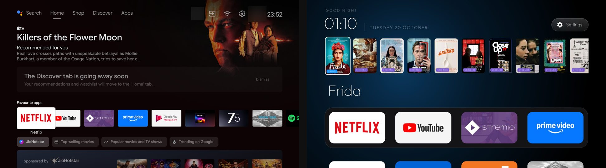

# Just the apps

**Your Hisense Android TV, minus everything that isn't your apps.** It moves without stutter, the home screen
has no ads, and your IMDb watchlist sits on it with each title labelled with where you can watch it.



## Why this exists

> "I watch TV less because I hate the slow start-up and the laggy scrolling. I just want the apps."

That was the brief, from the owner of a three-year-old Hisense 55U6G. The panel was fine. What sat around
the apps was not: a home screen with a sponsored row and Shop and Discover tabs, a shop demo mode, a data
saver nobody turned on, a partner installer that adds apps by itself, and ten apps waking up in the minute
after every start. The home screen alone used 117 MB on a TV with under 2 GB of memory.

## What changes

**A home screen that's only your apps.** Your four favourites sit in a row along the bottom, with the rest
in a grid below. There are no sponsored rows, tabs or recommendations from apps you don't use.

**Moving around feels instant.** On a 55U6G, janky frames on the home screen dropped from 24% to 3.3%, and
the slowest frames from 65 ms to 18 ms. We pressed the same keys before and after and read the TV's own
frame stats.

**Your watchlist, with where to watch it.** Your IMDb watchlist shows as a row of posters, newest first,
each tagged NETFLIX, PRIME, HOTSTAR and so on. Press OK and that title's page opens inside the app, ready to
play. Titles that aren't on your apps open in Stremio, if you use it.

**Less running behind your back.** About twenty packages are switched off: Hisense and Google usage
reporting, the shop demo, the partner app installer, Data Saver (67 MB, always running), a spare keyboard,
and the stock home screen with its recommendation feeds.

**Fewer ads inside apps, if you want it.** One setting sends the TV's lookups through AdGuard's DNS, so
ad and tracking servers stop answering in every app. YouTube ads stay, because they come from the same
servers as the videos.

**It stays this way.** Firmware updates are switched off (this TV's last one was in December 2021). If an
update or a factory reset ever undoes the setup, one command puts it all back.

## What it won't do

- **Cold start still takes about 25 seconds.** That's the firmware. Turn the TV off with the remote rather
  than the wall switch: waking from standby is quick.
- **YouTube ads stay**, for the reason above.
- **Prime Video still asks who's watching** before it opens a title.
- **Hisense TVs running VIDAA** (not Android) can't be changed this way.

## What you need

- A Hisense TV running Android TV. Settings → Device Preferences → About will say so.
- A laptop on the same Wi-Fi (Mac, Windows or Linux).
- [Claude Code](https://claude.com/claude-code) or a similar assistant that can run commands.
- About 30 minutes, most of it the TV restarting while you wait.

## How it works

1. **Turn on USB debugging on the TV.** It's four presses in Settings; [PROMPT.md](PROMPT.md) shows where.
2. **Paste the prompt into your assistant**, with your TV's IP address, the apps you use and, if you like,
   your IMDb watchlist link.
3. **Answer a few questions:** which four apps go in the row, whether a set-top box is plugged in, and
   whether you want the ad-blocking DNS.

The assistant backs up the TV first. It then switches things off in small groups, restarting the TV and
checking it after each one. It installs the new home screen, then shows you the before and after numbers.

Want to see what the watchlist row would show before you start? Run
`python3 tools/watchlist-preview.py "<your IMDb watchlist link>"` and it lists where each title streams.

## Safe by design

- **Nothing is deleted from the TV's system.** Packages are switched off, and one command switches them
  back on. Settings → Apps on the TV can do it too.
- **A full backup comes first**: every package, every setting and an undo script.
- **Changes go in small groups**, with a restart and a health check after each: did it boot, is Home there,
  are the HDMI inputs still listed, is the keyboard set.
- **Packages known to break Hisense TVs are never touched**, including the SmartSense family that sent
  another Hisense model into a recovery screen.
- **Your apps' dependencies are kept.** If you sideloaded an app, the app you used to install it stays.
- **The new home screen has no ads, no tracking and no background service.** It only goes online for the
  watchlist, at most once every 12 hours, and only while the home screen is open.

## Keeping it

After a firmware update or a factory reset, with USB debugging on:

```
sh tools/reapply.sh           # put back whatever has changed
sh tools/reapply.sh --check   # just show what has changed
```

Everything personal (your TV's address, your backup, your app list, your watchlist settings) lives in
`my-tv/`. It never leaves your laptop, so back it up.

## Tested on

| TV | What was tested |
|---|---|
| Hisense 55U6G (HiSmartTV A4, Android TV 9, India) | Full setup, October 2026 |

Have another Hisense model? The prompt works out the list for your TV, checking each unfamiliar package
before it touches it. Then add your TV to [devices/](devices/) so the next person can skip that step.

## Questions

**Could this break my TV?** Everything can be undone, and nothing is flashed or rooted. The worst case
reported on another Hisense was a recovery screen at start-up. Choosing "Try again" booted it normally, and
the packages behind it are on the never-touch list.

**Will I lose my apps or sign-ins?** No. Your apps, their data and your accounts stay as they are.

**Will my apps still update?** Yes, through the Play Store as before. Stremio is the exception in India,
where it isn't on the Play Store.

**Where does the watchlist come from?** Your public IMDb watchlist, matched against JustWatch's streaming
listings for your country. Both are unofficial data feeds, so this is for personal use. If either changes,
the row keeps showing the last list it saved.

## Credits

The home screen app and the approach come from [cleanyourtv](https://github.com/Gathin23/cleanyourtv) by
Gathin, under the MIT licence. This project adds the Hisense package list, the watchlist row, and the tools
that back up, apply in safe groups and put the setup back after updates.
